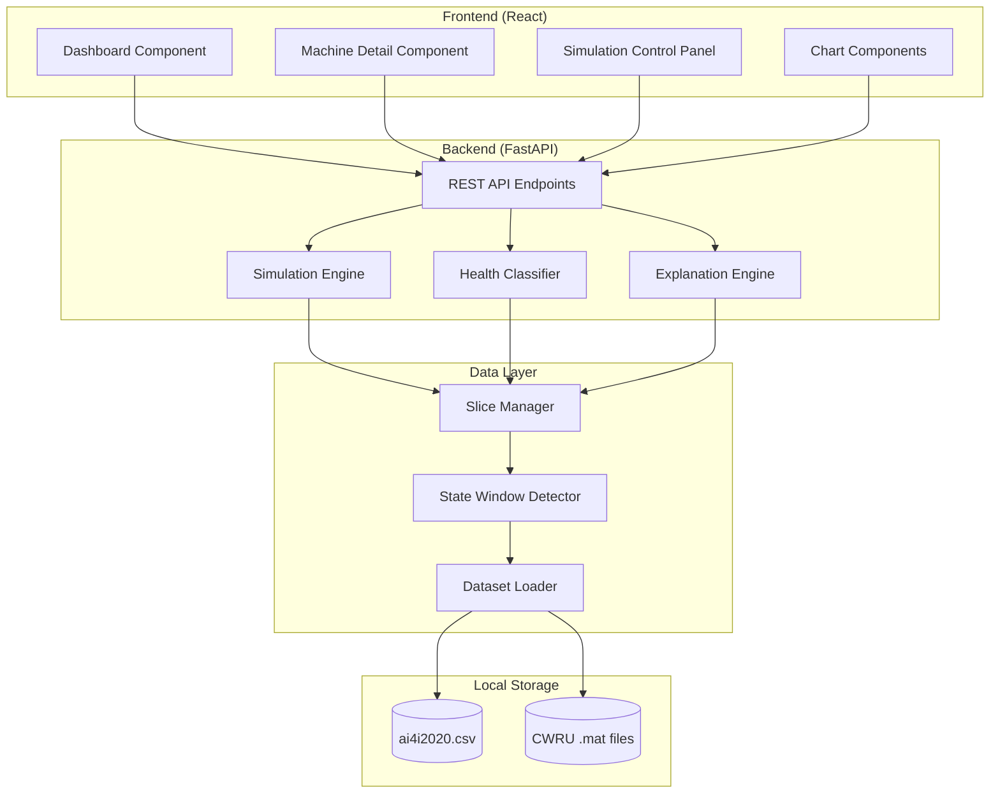
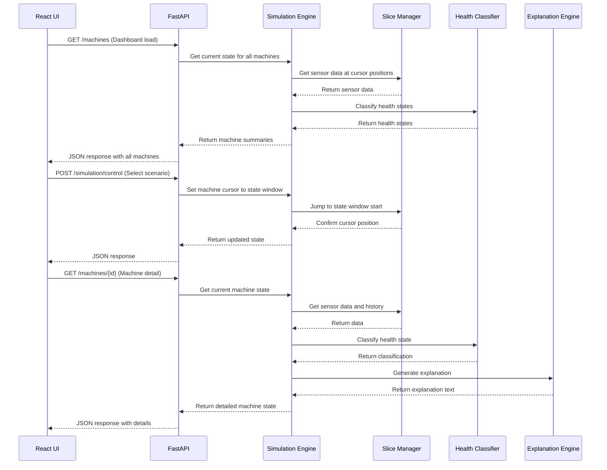

# Design Document: PRISM Predictive Maintenance System

## Overview

PRISM is a predictive maintenance system that monitors manufacturing equipment using local datasets and explainable AI techniques. The system architecture consists of three main layers:

1. **Data Layer**: Manages local datasets (AI4I and CWRU), partitions data into machine-specific slices, and identifies state windows
2. **Simulation & Analysis Layer**: Implements state-based simulation, health classification, trend analysis, and explanation generation
3. **API & UI Layer**: Provides REST API endpoints and React-based user interface

The system operates entirely offline using deterministic logic, avoiding black-box ML models and external API dependencies. The core innovation is the state-based simulation engine that allows jumping to specific machine conditions rather than linear replay.

## Architecture

### High-Level Architecture



### Component Interaction Flow



## Components and Interfaces

### 1. Dataset Loader

**Responsibility**: Load and parse local datasets from the datasets/ folder.

**Interface**:
```python
class DatasetLoader:
    def load_ai4i_dataset(self, filepath: str) -> pd.DataFrame:
        """Load AI4I dataset from CSV file"""
        
    def load_cwru_mat_file(self, filepath: str) -> np.ndarray:
        """Load CWRU bearing data from .mat file"""
        
    def load_cwru_features(self, filepath: str) -> pd.DataFrame:
        """Load CWRU feature CSV file"""
```

**Implementation Notes**:
- Uses pandas for CSV loading
- Uses scipy.io.loadmat for .mat files
- Validates file existence and format
- Returns raw data without transformation

### 2. Slice Manager

**Responsibility**: Partition AI4I dataset into machine-specific base slices and identify state windows.

**Interface**:
```python
class SliceManager:
    def __init__(self, ai4i_data: pd.DataFrame):
        """Initialize with full AI4I dataset"""
        
    def create_base_slices(self) -> Dict[str, pd.DataFrame]:
        """Partition dataset into 4 machine-specific slices"""
        
    def identify_state_windows(self, base_slice: pd.DataFrame) -> Dict[str, StateWindow]:
        """Identify Normal, Advisory, Action Required, Post-Maintenance windows"""
        
    def get_sensor_data_at_position(self, machine_id: str, position: int) -> Dict[str, float]:
        """Get sensor readings at specific cursor position"""
        
    def get_sensor_history(self, machine_id: str, position: int, window_size: int) -> pd.DataFrame:
        """Get rolling window of sensor history for trends"""
```

**Data Structures**:
```python
@dataclass
class StateWindow:
    state: str  # "Normal", "Advisory", "Action Required", "Post-Maintenance"
    start_index: int
    end_index: int
    machine_id: str
```

**Implementation Notes**:
- Partitions AI4I dataset into 4 roughly equal slices (one per machine)
- Uses statistical analysis to identify state windows:
  - Normal: Low variance, values within normal ranges
  - Advisory: Increasing trends, approaching thresholds
  - Action Required: Values exceeding critical thresholds
  - Post-Maintenance: Transition from high to normal values
- Uses Isolation Forest for anomaly detection to help identify state boundaries
- Stores base slices and state windows in memory for fast access

### 3. Simulation Engine

**Responsibility**: Manage simulation state, cursors, and scenario selection for all machines.

**Interface**:
```python
class SimulationEngine:
    def __init__(self, slice_manager: SliceManager):
        """Initialize with slice manager"""
        
    def set_scenario(self, machine_id: str, scenario: str) -> None:
        """Jump cursor to start of specified state window"""
        
    def advance_cursor(self, machine_id: str, steps: int = 1) -> None:
        """Move cursor forward within current state window"""
        
    def get_current_state(self, machine_id: str) -> MachineState:
        """Get current machine state at cursor position"""
        
    def get_all_machines_state(self) -> List[MachineState]:
        """Get current state for all 4 machines"""
```

**Data Structures**:
```python
@dataclass
class MachineState:
    machine_id: str
    machine_name: str
    health_state: str
    cursor_position: int
    current_window: StateWindow
    sensor_readings: Dict[str, float]
    one_line_summary: str
```

**Implementation Notes**:
- Maintains independent cursor for each machine
- Cursors can only move within current state window
- Scenario selection jumps cursor to window start
- Provides bounds checking to prevent cursor overflow

### 4. Health Classifier

**Responsibility**: Classify machine health state based on sensor readings using deterministic rules and lightweight ML.

**Interface**:
```python
class HealthClassifier:
    def classify(self, sensor_readings: Dict[str, float], 
                 sensor_history: pd.DataFrame) -> HealthClassification:
        """Classify health state from current and historical sensor data"""
        
    def detect_anomalies(self, sensor_readings: Dict[str, float]) -> List[str]:
        """Detect which sensors show anomalous values"""
        
    def calculate_trends(self, sensor_history: pd.DataFrame) -> Dict[str, str]:
        """Calculate trend direction for each sensor (rising, falling, stable)"""
```

**Data Structures**:
```python
@dataclass
class HealthClassification:
    health_state: str  # "Normal", "Advisory", "Action Required", "Post-Maintenance"
    anomalous_sensors: List[str]
    sensor_trends: Dict[str, str]  # sensor_name -> "rising"/"falling"/"stable"
    threshold_violations: Dict[str, float]  # sensor_name -> violation_amount
```

**Implementation Notes**:
- Uses threshold-based rules as primary classification method:
  - Temperature > 310K → Advisory, > 320K → Action Required
  - Vibration > 50 μm → Advisory, > 70 μm → Action Required
  - Torque > 50 Nm → Advisory, > 60 Nm → Action Required
- Uses Isolation Forest (sklearn) for anomaly detection as secondary signal
- Calculates trends using linear regression on rolling window
- Combines multiple signals for final classification
- Deterministic: same inputs always produce same outputs

### 5. Explanation Engine

**Responsibility**: Generate human-readable explanations using deterministic template-based logic.

**Interface**:
```python
class ExplanationEngine:
    def generate_explanation(self, health_classification: HealthClassification,
                            sensor_readings: Dict[str, float]) -> Explanation:
        """Generate full explanation for current machine state"""
        
    def identify_affected_component(self, health_classification: HealthClassification) -> str:
        """Determine which component is affected"""
        
    def generate_recommendation(self, health_state: str, 
                               affected_component: str) -> str:
        """Generate recommended action"""
```

**Data Structures**:
```python
@dataclass
class Explanation:
    explanation_text: str
    affected_component: str
    recommended_action: str
    bearing_evidence_required: bool
```

**Template Logic**:
```python
# Example template rules
if "vibration" in anomalous_sensors and trend == "rising":
    explanation = "Vibration levels are increasing, indicating potential bearing wear or shaft imbalance."
    affected_component = "Bearings"
    
if "temperature" in anomalous_sensors and "torque" in anomalous_sensors:
    explanation = "Elevated temperature combined with high torque suggests mechanical stress or insufficient lubrication."
    affected_component = "Drive system"
    
if health_state == "Normal":
    explanation = "All sensors are within normal operating ranges. The machine is operating as expected."
    affected_component = "None"
```

**Implementation Notes**:
- Uses rule-based templates mapped to sensor patterns
- No LLM APIs or probabilistic text generation
- Calm, actionable language without confidence percentages
- Maps sensor combinations to mechanical meanings
- Deterministic: same classification always produces same explanation

### 6. CWRU Evidence Provider

**Responsibility**: Provide bearing vibration evidence from CWRU dataset based on health state.

**Interface**:
```python
class CWRUEvidenceProvider:
    def __init__(self, data_loader: DatasetLoader):
        """Initialize with dataset loader"""
        
    def get_bearing_evidence(self, health_state: str) -> Optional[BearingEvidence]:
        """Get bearing vibration data for current health state"""
        
    def should_show_evidence(self, affected_component: str) -> bool:
        """Determine if bearing evidence is relevant"""
```

**Data Structures**:
```python
@dataclass
class BearingEvidence:
    health_state: str
    vibration_data: np.ndarray
    sample_rate: int
    description: str
```

**Mapping Rules**:
- Normal → Time_Normal_1_098.mat
- Advisory → B014_1_190.mat (Ball defect)
- Action Required → IR014_1_175.mat (Inner race defect) or OR014_6_1_202.mat (Outer race defect)
- Post-Maintenance → Time_Normal_1_098.mat

**Implementation Notes**:
- Only provides evidence when affected component is bearing-related
- Loads appropriate .mat file based on health state
- Extracts time-domain vibration signal
- Can compute FFT for frequency domain visualization if needed

### 7. FastAPI Backend

**Responsibility**: Provide REST API endpoints for frontend communication.

**Endpoints**:
```python
# Get all machines summary (for Dashboard)
GET /api/machines
Response: {
    "machines": [
        {
            "machine_id": "CNC-MILL-01",
            "machine_name": "CNC Milling Machine",
            "health_state": "Normal",
            "one_line_summary": "Operating normally"
        },
        ...
    ],
    "global_alerts": [...],
    "global_advisories": [...]
}

# Get detailed machine information
GET /api/machines/{machine_id}
Response: {
    "machine_id": "CNC-MILL-01",
    "machine_name": "CNC Milling Machine",
    "health_state": "Advisory",
    "sensor_readings": {
        "temperature": 305.2,
        "vibration": 52.3,
        "torque": 45.1,
        ...
    },
    "sensor_history": [...],
    "explanation": "Vibration levels are increasing...",
    "affected_component": "Bearings",
    "recommended_action": "Schedule bearing inspection within 48 hours",
    "bearing_evidence": {...}
}

# Control simulation
POST /api/simulation/control
Request: {
    "machine_id": "CNC-MILL-01",
    "action": "set_scenario",
    "scenario": "Advisory"
}
Response: {
    "success": true,
    "machine_id": "CNC-MILL-01",
    "new_state": {...}
}

# Advance simulation
POST /api/simulation/advance
Request: {
    "machine_id": "CNC-MILL-01",
    "steps": 1
}
Response: {
    "success": true,
    "machine_id": "CNC-MILL-01",
    "new_state": {...}
}
```

**Implementation Notes**:
- Uses FastAPI for async request handling
- CORS enabled for local development
- Error handling with appropriate HTTP status codes
- JSON serialization for all responses

### 8. React Frontend Components

#### Dashboard Component
**Responsibility**: Display overview of all machines with global alerts and advisories.

**Structure**:
```jsx
function Dashboard() {
    const [machinesData, setMachinesData] = useState(null);
    
    useEffect(() => {
        // Fetch /api/machines
        // Update every 2 seconds if simulation is running
    }, []);
    
    return (
        <div>
            <GlobalAlerts alerts={machinesData.global_alerts} />
            <GlobalAdvisories advisories={machinesData.global_advisories} />
            <MachineGrid machines={machinesData.machines} />
        </div>
    );
}
```

#### Machine Detail Component
**Responsibility**: Display detailed information for a single machine.

**Structure**:
```jsx
function MachineDetail({ machineId }) {
    const [machineData, setMachineData] = useState(null);
    
    useEffect(() => {
        // Fetch /api/machines/{machineId}
    }, [machineId]);
    
    return (
        <div>
            <MachineHeader name={machineData.machine_name} 
                          healthState={machineData.health_state} />
            <SensorReadings readings={machineData.sensor_readings} />
            <TrendCharts history={machineData.sensor_history} />
            <ExplanationPanel explanation={machineData.explanation}
                            affectedComponent={machineData.affected_component}
                            recommendation={machineData.recommended_action} />
            {machineData.bearing_evidence && 
                <BearingEvidencePanel evidence={machineData.bearing_evidence} />}
        </div>
    );
}
```

#### Simulation Control Panel Component
**Responsibility**: Allow scenario selection and simulation control.

**Structure**:
```jsx
function SimulationControlPanel() {
    const [selectedMachine, setSelectedMachine] = useState("CNC-MILL-01");
    const [selectedScenario, setSelectedScenario] = useState("Normal");
    
    const handleSetScenario = async () => {
        // POST /api/simulation/control
    };
    
    const handleAdvance = async () => {
        // POST /api/simulation/advance
    };
    
    return (
        <div>
            <MachineSelector value={selectedMachine} 
                           onChange={setSelectedMachine} />
            <ScenarioSelector value={selectedScenario}
                            onChange={setSelectedScenario} />
            <Button onClick={handleSetScenario}>Set Scenario</Button>
            <Button onClick={handleAdvance}>Advance Simulation</Button>
        </div>
    );
}
```

#### Chart Components
**Responsibility**: Visualize sensor trends and bearing evidence.

**Implementation**:
- Use Recharts library for time-series line charts
- Display rolling window of recent sensor history
- Support multiple sensors on same chart with different colors
- Display bearing vibration waveforms when evidence is available

## Data Models

### AI4I Dataset Schema
The AI4I 2020 Predictive Maintenance Dataset contains the following columns:
- **UDI**: Unique identifier
- **Product ID**: Product identifier
- **Type**: Product quality variant (L, M, H)
- **Air temperature [K]**: Process air temperature
- **Process temperature [K]**: Process temperature
- **Rotational speed [rpm]**: Rotational speed
- **Torque [Nm]**: Torque
- **Tool wear [min]**: Tool wear time
- **Machine failure**: Binary failure indicator
- **TWF, HDF, PWF, OSF, RNF**: Failure mode flags

### CWRU Dataset Structure
CWRU bearing dataset files contain:
- **Time-domain vibration signals**: Raw acceleration data
- **Sampling rate**: 12kHz or 48kHz depending on file
- **Bearing condition**: Normal, Ball defect, Inner race defect, Outer race defect

### Internal Data Models

**Machine Configuration**:
```python
MACHINES = {
    "CNC-MILL-01": {
        "name": "CNC Milling Machine",
        "base_slice_range": (0, 2500)
    },
    "COOL-PUMP-02": {
        "name": "Industrial Cooling Pump",
        "base_slice_range": (2500, 5000)
    },
    "CONV-MOTOR-01": {
        "name": "Conveyor Drive Motor",
        "base_slice_range": (5000, 7500)
    },
    "AIR-COMP-01": {
        "name": "Air Compressor Unit",
        "base_slice_range": (7500, 10000)
    }
}
```

**Sensor Thresholds**:
```python
THRESHOLDS = {
    "temperature": {
        "advisory": 310,  # Kelvin
        "action_required": 320
    },
    "vibration": {
        "advisory": 50,  # μm
        "action_required": 70
    },
    "torque": {
        "advisory": 50,  # Nm
        "action_required": 60
    },
    "rotational_speed": {
        "advisory_low": 1200,  # rpm
        "advisory_high": 2800
    }
}
```


## Correctness Properties

*A property is a characteristic or behavior that should hold true across all valid executions of a system—essentially, a formal statement about what the system should do. Properties serve as the bridge between human-readable specifications and machine-verifiable correctness guarantees.*

### Property Reflection

After analyzing all acceptance criteria, several redundancies were identified:
- Requirements 1.5 and 4.4 both test cursor independence (consolidated into Property 2)
- Requirements 4.6, 18.1, 18.2, 18.3, 18.5 all test determinism (consolidated into Property 1)
- Requirements 9.1 and 9.2 test similar filtering logic (consolidated into Property 8)
- Requirements 5.3 and 6.3 both test cursor advancement updates (consolidated into Property 4)
- Multiple requirements test API endpoint existence (consolidated into examples, not properties)

### Core Properties

**Property 1: Deterministic Simulation Behavior**

*For any* machine and cursor position, querying the system state multiple times should always return identical sensor readings, health state, explanation text, affected component, and recommended action.

**Validates: Requirements 4.6, 18.1, 18.2, 18.3, 18.5**

**Property 2: Independent Machine Cursors**

*For any* machine, advancing its simulation cursor should not change the cursor position, sensor readings, or health state of any other machine.

**Validates: Requirements 1.5, 4.4**

**Property 3: Health State Exclusivity**

*For any* machine at any cursor position, the machine should be classified into exactly one health state from the set {Normal, Advisory, Action Required, Post-Maintenance}.

**Validates: Requirements 2.1**

**Property 4: Cursor Advancement Updates State**

*For any* machine, when the simulation cursor advances to a new position, the sensor readings returned by the API should differ from the previous position (unless at window boundary).

**Validates: Requirements 1.4, 5.3, 6.3**

**Property 5: Scenario Selection Jumps to Window Start**

*For any* machine and scenario selection, setting the scenario should position the cursor at the start index of the corresponding state window.

**Validates: Requirements 4.2, 13.4**

**Property 6: Cursor Bounds Enforcement**

*For any* machine, advancing the simulation cursor should never move the cursor outside the boundaries of the currently selected state window.

**Validates: Requirements 4.3**

**Property 7: Data Source Integrity**

*For any* machine and cursor position, all sensor values returned by the API should exactly match the corresponding row in the AI4I dataset without modification.

**Validates: Requirements 3.6, 5.5**

**Property 8: Global Alerts Match Machine States**

*For any* system state, the global alerts list should contain exactly those machines whose health state is "Action Required", and the global advisories list should contain exactly those machines whose health state is "Advisory".

**Validates: Requirements 9.1, 9.2, 9.5**

**Property 9: All Machines Have Required Data**

*For any* machine, the API response should include non-empty values for machine_id, machine_name, health_state, and one_line_summary.

**Validates: Requirements 1.2, 1.3**

**Property 10: Machine Detail Completeness**

*For any* machine, the detailed API response should include all required fields: machine_id, machine_name, health_state, sensor_readings (with temperature, vibration, torque, rotational_speed, tool_wear), explanation, affected_component, and recommended_action.

**Validates: Requirements 5.1, 5.2, 10.2, 10.3**

**Property 11: Sensor History Rolling Window**

*For any* machine, the sensor history returned should have a bounded length (rolling window) and should update to include new data points when the cursor advances.

**Validates: Requirements 6.1, 6.2**

**Property 12: Explanation Non-Probabilistic Language**

*For any* machine state, the explanation text should not contain probability percentages (%, "percent"), confidence scores, or probabilistic language ("probably", "likely", "maybe").

**Validates: Requirements 7.7, 18.4**

**Property 13: Bearing Evidence Conditional Display**

*For any* machine, bearing vibration evidence should be present in the response if and only if the affected component is bearing-related and the health state is Advisory or Action Required.

**Validates: Requirements 8.1, 8.4**

**Property 14: Bearing Evidence Contains Vibration Data**

*For any* machine where bearing evidence is provided, the evidence structure should contain a non-empty vibration waveform array.

**Validates: Requirements 8.3**

**Property 15: Recommendation Urgency Matches Health State**

*For any* machine in Advisory state, the recommended action should contain monitoring or inspection keywords; for any machine in Action Required state, the recommended action should contain immediate or urgent action keywords.

**Validates: Requirements 12.1, 12.2, 12.5**

**Property 16: API Error Handling**

*For any* invalid API request (invalid machine ID, invalid scenario, invalid cursor position), the system should return an appropriate HTTP error status code (4xx) and a JSON response containing an error message.

**Validates: Requirements 14.5, 14.6**

**Property 17: State Window Coverage**

*For any* machine, the identified state windows should cover all four health states (Normal, Advisory, Action Required, Post-Maintenance) with non-overlapping index ranges.

**Validates: Requirements 3.5**

**Property 18: Threshold-Based Classification**

*For any* sensor readings where temperature > 320K OR vibration > 70 OR torque > 60, the health state should be classified as Action Required; for readings where 310K < temperature ≤ 320K OR 50 < vibration ≤ 70 OR 50 < torque ≤ 60, the health state should be Advisory or Action Required.

**Validates: Requirements 2.2, 2.3, 2.4**

**Property 19: Navigation Preserves Simulation State**

*For any* machine, querying the machine list endpoint followed by the machine detail endpoint should return the same cursor position and health state for that machine.

**Validates: Requirements 10.5**

### Example-Based Tests

The following criteria are best validated through specific examples rather than universal properties:

**Example 1: Four Fixed Machines**
- Verify system returns exactly 4 machines with IDs: CNC-MILL-01, COOL-PUMP-02, CONV-MOTOR-01, AIR-COMP-01
- **Validates: Requirements 1.1**

**Example 2: Dataset Files Loaded**
- Verify system loads ai4i2020.csv from datasets/ folder
- Verify system loads CWRU .mat files from datasets/ folder
- **Validates: Requirements 3.1, 3.2, 3.3**

**Example 3: Four Base Slices Created**
- Verify system creates exactly 4 base slices on startup
- Verify each machine is assigned to one slice
- **Validates: Requirements 3.4**

**Example 4: Post-Maintenance State Transition**
- Set machine to Action Required state, then advance to Post-Maintenance window
- Verify health state transitions correctly
- **Validates: Requirements 2.5**

**Example 5: Cursor End Boundary Behavior**
- Advance cursor to end of state window
- Attempt to advance further
- Verify cursor stops or loops within window
- **Validates: Requirements 4.5**

**Example 6: Trend Chart Sensors**
- Query machine detail endpoint
- Verify sensor_history includes at least temperature, vibration, and torque
- **Validates: Requirements 6.4**

**Example 7: Rising Vibration Explanation**
- Set machine to state with rising vibration trend
- Verify explanation contains "bearing" or "imbalance" keywords
- **Validates: Requirements 7.3**

**Example 8: High Torque + Temperature Explanation**
- Set machine to state with high torque and high temperature
- Verify explanation contains "stress" or "lubrication" keywords
- **Validates: Requirements 7.4**

**Example 9: Normal State Explanation**
- Set machine to Normal state
- Verify explanation confirms normal operation
- **Validates: Requirements 7.5**

**Example 10: No External API Calls**
- Monitor network activity during system operation
- Verify no calls to external APIs (especially LLM services)
- **Validates: Requirements 7.2, 16.1**

**Example 11: CWRU File Mapping**
- Set machine to Normal state → verify Time_Normal_1_098.mat is used
- Set machine to Advisory state → verify B014_1_190.mat is used
- Set machine to Action Required state → verify IR014_1_175.mat or OR014_6_1_202.mat is used
- **Validates: Requirements 8.2**

**Example 12: Empty Alerts and Advisories**
- Set all machines to Normal state
- Verify global_alerts and global_advisories are empty lists
- **Validates: Requirements 9.3, 9.4**

**Example 13: Machine Detail Navigation**
- Query /api/machines/{machine_id} endpoint
- Verify endpoint returns 200 status and machine details
- **Validates: Requirements 10.1**

**Example 14: Vibration Affects Bearings**
- Set machine to state with elevated vibration only
- Verify affected_component is "Bearings" or similar
- **Validates: Requirements 11.3**

**Example 15: Temperature Affects Cooling**
- Set machine to state with elevated temperature only (no vibration)
- Verify affected_component is "Cooling system" or "Lubrication system"
- **Validates: Requirements 11.4**

**Example 16: Normal State No Affected Component**
- Set machine to Normal state
- Verify affected_component indicates no issues or normal operation
- **Validates: Requirements 11.5**

**Example 17: Normal State Recommendation**
- Set machine to Normal state
- Verify recommended_action suggests continued normal operation
- **Validates: Requirements 12.3**

**Example 18: Simulation Control Endpoints**
- Verify POST /api/simulation/control endpoint accepts machine_id and scenario
- Verify POST /api/simulation/advance endpoint accepts machine_id and steps
- **Validates: Requirements 13.2, 13.3, 13.5**

**Example 19: API Endpoints Exist**
- Verify GET /api/machines endpoint exists and returns machine list
- Verify GET /api/machines/{machine_id} endpoint exists and returns machine details
- Verify POST /api/simulation/control endpoint exists
- **Validates: Requirements 14.2, 14.3, 14.4**

**Example 20: CPU-Only Operation**
- Run system on CPU-only environment (no GPU)
- Verify all functionality works correctly
- **Validates: Requirements 15.5**

**Example 21: Offline Operation**
- Disconnect network/internet
- Run system and verify all functionality works
- **Validates: Requirements 16.2, 16.3, 16.5**

## Error Handling

### Dataset Loading Errors
- **Missing dataset files**: Return clear error message indicating which file is missing and expected location
- **Corrupted dataset files**: Catch parsing exceptions and return error with file name
- **Invalid dataset format**: Validate expected columns exist in AI4I dataset, validate .mat file structure

### Simulation Errors
- **Invalid machine ID**: Return 404 with error message listing valid machine IDs
- **Invalid scenario**: Return 400 with error message listing valid scenarios
- **Cursor out of bounds**: Prevent cursor from exceeding window boundaries, log warning if attempted

### API Errors
- **Malformed requests**: Return 400 with validation error details
- **Server errors**: Return 500 with generic error message (log detailed error server-side)
- **Missing required fields**: Return 400 with list of missing fields

### ML Model Errors
- **Model fitting failures**: Fall back to threshold-based classification only
- **Anomaly detection errors**: Log error and continue with threshold-based logic
- **Trend calculation errors**: Return "stable" trend if calculation fails

### Error Response Format
All API errors should return JSON in this format:
```json
{
    "error": true,
    "message": "Human-readable error description",
    "code": "ERROR_CODE",
    "details": {}
}
```

## Testing Strategy

### Dual Testing Approach

The system will use both unit tests and property-based tests for comprehensive coverage:

**Unit Tests**: Focus on specific examples, edge cases, and integration points
- Test specific machine IDs and dataset files (Examples 1-3)
- Test specific state transitions (Example 4)
- Test boundary conditions (Example 5)
- Test specific explanation templates (Examples 7-9)
- Test API endpoint existence (Examples 13, 18, 19)
- Test specific component identification rules (Examples 14-16)
- Test offline operation (Examples 20-21)

**Property-Based Tests**: Verify universal properties across all inputs
- Test determinism across random cursor positions (Property 1)
- Test cursor independence across random machine selections (Property 2)
- Test health state exclusivity across all machines and positions (Property 3)
- Test data integrity across random positions (Property 7)
- Test global alerts consistency across random machine states (Property 8)
- Test API completeness across all machines (Properties 9-10)
- Test explanation language across all states (Property 12)
- Test bearing evidence logic across all states (Properties 13-14)
- Test recommendation urgency across all states (Property 15)

### Property-Based Testing Configuration

**Library**: Use Hypothesis (Python) for backend property tests
**Minimum iterations**: 100 runs per property test
**Test tagging**: Each property test must include a comment referencing the design property

Example test structure:
```python
from hypothesis import given, strategies as st

@given(
    machine_id=st.sampled_from(["CNC-MILL-01", "COOL-PUMP-02", "CONV-MOTOR-01", "AIR-COMP-01"]),
    cursor_position=st.integers(min_value=0, max_value=1000)
)
def test_deterministic_simulation_behavior(machine_id, cursor_position):
    """
    Feature: prism-predictive-maintenance, Property 1: Deterministic Simulation Behavior
    For any machine and cursor position, querying the system state multiple times 
    should always return identical results.
    """
    # Set cursor position
    sim_engine.set_cursor(machine_id, cursor_position)
    
    # Query state twice
    state1 = sim_engine.get_current_state(machine_id)
    state2 = sim_engine.get_current_state(machine_id)
    
    # Assert all fields are identical
    assert state1.sensor_readings == state2.sensor_readings
    assert state1.health_state == state2.health_state
    assert state1.explanation == state2.explanation
    assert state1.affected_component == state2.affected_component
    assert state1.recommended_action == state2.recommended_action
```

### Test Coverage Goals

- **Unit test coverage**: Minimum 80% code coverage for core logic
- **Property test coverage**: All 19 properties must have corresponding property tests
- **Integration tests**: Test full API request/response cycles
- **Edge case tests**: All 21 example tests must be implemented

### Testing Phases

1. **Data Layer Tests**: Verify dataset loading, slicing, and state window detection
2. **Simulation Engine Tests**: Verify cursor management and state-based simulation
3. **Classification Tests**: Verify health state classification logic
4. **Explanation Tests**: Verify explanation generation and template logic
5. **API Tests**: Verify all endpoints, error handling, and response formats
6. **Integration Tests**: Verify end-to-end flows from API request to response
7. **Property Tests**: Run all 19 property-based tests with 100+ iterations each
